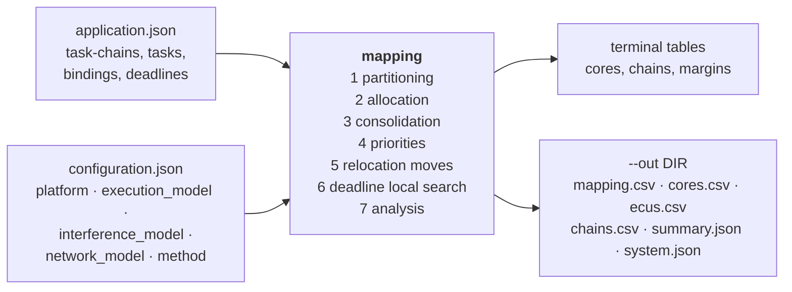

# System-level mapping of automotive applications onto zonal E/E architectures: allocation, contention, LET, TSN and the life of the platform

**mapping** sizes the computing platform of a vehicle. You describe the
software as task-chains that run from a sensor to an actuator, and the
hardware as ECUs, cores and a TSN backbone. The tool then works out three
things:

- how many cores each ECU needs, and on which core each task runs;
- whether every task-chain meets its end-to-end deadline once its tasks
  are spread over cores and over the network;
- how much margin is left for the software updates of the coming years.

It is a system-level method: the allocation of the tasks, the
fixed-priority scheduling of every core, the shared-memory contention
between cores, the communication between cores and the TSN network are
decided and analysed together. Every response time, delay and reaction
time it reports is a worst-case bound, backed by an analysis with proofs;
what it cannot bound (a task above its period, an overloaded port) it
reports as unbounded.

<p align="center">
  <a href="paper/ifupauline2026-system-level-mapping-automotive.pdf"><b>📄 Paper</b></a>
  &nbsp;·&nbsp;
  <a href="manual/ifupauline2026-mapping-user-manual.pdf"><b>📘 User manual</b></a>
  &nbsp;·&nbsp;
  <a href="examples/"><b>🚗 Five use cases</b></a>
</p>

## Highlights

- **Beyond zonal.** The built-in platform is zonal: a central
  computer and five zone controllers. A configuration file can describe
  any other platform: domain, hybrid or distributed ECUs, big, little,
  microcontroller and lock-step cores of any speed, memory, and a largest
  number of cores per ECU.
- **Allocation.** Tasks are packed by bin packing (best, worst or first
  fit) or by a communication-aware rule, then the cores are consolidated.
  The allocation respects:
  - the ECUs that sensors and actuators are wired to;
  - memory;
  - separation of redundant task-chains;
  - co-location;
  - allowed core types.
- **Scheduling.** Fixed priorities come from an optimal, precedence-preserving
  variant of Audsley's algorithm. Response times include shared-memory
  contention.
- **Communication.** Data crosses between cores at Logical Execution
  Time (LET) instants, with implicit communication (the default) or strict
  LET. Network Calculus bounds cover:
  - credit-based shaping (802.1Qav);
  - time-aware shaping (802.1Qbv);
  - asynchronous traffic shaping (802.1Qcr);
  - frame replication (802.1CB).

  They hold on star, tree, ring and custom switched topologies.
- **End-to-end timing.** The tool bounds the maximum reaction time of every
  task-chain. A deadline-driven local search with an exact incremental
  re-analysis then reduces the number of late task-chains.
- **Close to optimal, and fast.**
  - An exact CP-SAT formulation measures the gap: on the zonal platform
    the heuristic is 2.3 to 2.9 % above the optimal allocation of its
    sub-chains on average, and proven optimal in 81 % of 140 instances;
    within 1.2 % on a hybrid platform and 4.7 % on a domain one.
  - The heuristic takes milliseconds. On the default platform, simulated
    annealing needs seconds to come as close; on harder platforms, a
    genetic algorithm run for tens of seconds does better than the
    heuristic.
- **Checked by simulation.**
  - A frame-level simulation of the network: no delay exceeded its bound
    over 3377 flows.
  - A full-system simulation of the tasks, LET and the network: no delay
    exceeded its bound over 9000 task-chains, with implicit communication
    or strict LET.
- **Life of the platform.** The tool sizes the hardware at the start of
  production, then adds software updates to the fixed hardware.
- **Scale.** A whole vehicle of 2000 task-chains is mapped in about a
  second.

## About this project

This project originated from an idea conceived during my PhD that I
couldn't pursue at the time. It is an independent continuation built with
the help of AI tools, which assisted in developing the method, code, and
paper.

## How it works



## Quick start

```sh
cmake -S . -B build && cmake --build build -j
(cd build && ctest --output-on-failure)

build/bin/mapping                                  # 300 generated task-chains, built-in zonal platform
build/bin/mapping --example-application > app.json # a small application file to start from
build/bin/mapping --example-config zonal > hw.json  # its platform; also domain, hybrid, distributed
build/bin/mapping app.json hw.json --out results-app # map it, and write the result files
build/bin/mapping --help
```

You need a C11 compiler, CMake ≥ 3.10 and, optionally, OpenMP. The
figures, the exact solver and the simulators also need Python 3 with
`numpy`, `matplotlib` and `ortools` (`pip install -r requirements.txt`).

## Input files

Both files are JSON. The tool checks them strictly: an unknown key or a
value out of range is an error that gives the file, the line and the key.

**Application.** Each task-chain is a list of tasks. A task must have a
period and a WCET on the reference core. It can also have:

- the ECU it is bound to (a sensor or actuator driver), or the ECUs it is
  allowed on;
- the core types it may run on, and its WCET factor on each type;
- its memory and its message size;
- its memory accesses, for contention;
- a request to share a core with the next task.

A task-chain can have an end-to-end deadline and a replica group.

```json
{"name": "brake_by_wire", "deadline_us": 10000, "tasks": [
  {"name": "pedal_sensor",  "period_us": 1000, "wcet_us": 40,  "ecu": "ZCU1", "message_bytes": 16},
  {"name": "brake_control", "period_us": 1000, "wcet_us": 120, "message_bytes": 32},
  {"name": "caliper_fl",    "period_us": 1000, "wcet_us": 30,  "ecu": "ZCU2"}]}
```

**Configuration.** It has five sections. Each is optional, and the
defaults are those of the built-in zonal platform.

| section | what it describes |
|---|---|
| `platform` | the ECUs: role (`central`, `zone`, `domain`, `ecu`), cores by type and speed, memory, the type of added cores, the largest number of cores |
| `execution_model` | fixed-priority preemptive scheduling, communication between cores (implicit or strict LET), utilization cap, WCET of the LET task, WCET margin |
| `interference_model` | shared-memory contention: round-robin arbitration, latency of a request, accesses per millisecond |
| `network_model` | TSN: topology (star, tree, ring, or custom switches and links), link rates, switch latency, CBS / TAS / ATS, traffic classes, frame preemption, FRER |
| `method` | allocation rule, sub-chain limit σ, affinity, consolidation, relocation (and optional swap) moves, local search, replica separation, fixed hardware, sizing for a target margin |

Ready-made platforms are in
[`examples/templates/`](examples/templates/): `zonal`, `domain`, `hybrid`
and `distributed`.

## Five use cases

Each use case in [`examples/`](examples/) has its own application and
configuration files. The [manual](manual/ifupauline2026-mapping-user-manual.pdf) runs each
one step by step.

| | use case | question |
|---|---|---|
| 1 | [`uc1_central_sizing`](examples/uc1_central_sizing/) | 24 functions of chassis, powertrain, ADAS, body and comfort move onto a central computer and five zone controllers: how many cores does the central computer need, and with what margin? |
| 2 | [`uc2_redundant_chassis`](examples/uc2_redundant_chassis/) | Fail-operational steering and braking: two redundant lanes on separate ECUs, safety monitors on lock-step cores, frames replicated around a ring (FRER). Is the platform enough, and what does the redundancy cost on the network? |
| 3 | [`uc3_tsn_streams`](examples/uc3_tsn_streams/) | Cameras, radars and a lidar share the switches with 1 ms control loops: which traffic shaping keeps the control loops on time, and what happens with a slower link? |
| 4 | [`uc4_software_updates`](examples/uc4_software_updates/) | The hardware is sized at the start of production with a margin, then frozen: do two later software updates still fit, and how should they be mapped? |
| 5 | [`uc5_hybrid_platform`](examples/uc5_hybrid_platform/) | A big.LITTLE central computer next to an ADAS domain controller, on a custom network with ATS: where does each function go, and how much does memory contention cost? |

## Results at a glance

These results are from the paper. Every number can be reproduced with
the commands below.

| question | result |
|---|---|
| Do the bounds hold in simulation? | No simulated delay exceeded its bound: 3377 network flows, and 9000 task-chains simulated as a whole system. The end-to-end bounds are reached exactly, or to within 1 %. |
| How far from the optimum? | 2.3 to 2.9 % above the optimal allocation on average, and proven optimal in 81 % of 140 instances of up to 300 task-chains, on the zonal platform. Within 1.2 % on a hybrid platform and 4.7 % on a domain one (100 more instances). |
| Against metaheuristics? | On the default platform, the heuristic is as close as simulated annealing run for 10⁶ moves, but takes milliseconds instead of seconds; a genetic algorithm stays up to 18 % above the optimum. On the harder platforms (slow zones, domain), a genetic algorithm run for tens of seconds recovers most of the heuristic's gap, and the exact formulation all of it. |
| What does communication awareness buy? | Two thirds fewer inter-ECU communications and more task-chains on time, for about 5 more cores. |
| Implicit communication or strict LET? | Strict LET shrinks the network bounds by 15 to 19 %, but every crossing between cores waits a full producer period: 30 points fewer task-chains on time with FFDU, 16 with CADU. |
| Other architectures? | The hybrid and domain platforms need about a core less than the zonal one, because part of the work bound to sensors runs on big cores. A distributed platform of small ECUs holds only half the applications of 300 task-chains. |
| Why cut task-chains? | Whole task-chains cost nothing on the default point, but under memory contention more than half the applications become infeasible; the default limit keeps them all feasible. |
| The rules of practice? | Putting all free software on the central computer costs cores and 31 % more communications, and leaves 7 points fewer task-chains on time. |
| The life of the platform? | Each core bought at the start of production buys about half a software update. |

## Reproducing the paper

```sh
build/bin/experiment all                                         # 24 experiments, CSV files in results/
build/bin/baselines results/baselines.csv results/baselines_trace.csv
for p in slow constraints domain; do build/bin/baselines b_$p.csv t_$p.csv --platform $p; done
(cat b_slow.csv; tail -n +2 b_constraints.csv; tail -n +2 b_domain.csv) > results/baselines_platforms.csv
python3 exact/gap.py build/bin/export_instance --sizes 20,50,100,200,300 --seeds 10
python3 exact/gap.py build/bin/export_instance --sizes 20,50,100,200,300 --seeds 10 \
        --configs domain,hybrid --out results/exact_architectures.csv
sh tests/netsim/run_netsim.sh build/bin/net_export tests/netsim/netsim.py 20000 2
sh tests/syssim/experiment.sh build/bin/mapping results/syssim.csv 5 4
(cd paper && make figures && make)
(cd manual && make listings && make)
```

The results are deterministic. They do not depend on the machine or on
the number of threads, apart from CPU times.

## Repository

| path | content |
|---|---|
| `src/`, `include/mapping/` | the C11 library: model, input files, partitioning, allocation, scheduling, network, metaheuristics |
| `tools/` | `mapping`, `experiment`, `baselines`, `export_instance`, `golden` |
| `examples/` | the four platform templates and the five use cases |
| `exact/` | the exact formulation (OR-Tools CP-SAT) and the optimality-gap study |
| `tests/` | unit tests, golden results, invariant checker, round-trip of the input files, frame-level network simulator, full-system simulator |
| `paper/` | the paper (LaTeX), its figures and tables |
| `manual/` | the user manual (LaTeX) |

## Citation

```bibtex
@misc{ifupauline2026mapping,
  author = {ifupauline},
  title  = {System-level mapping of automotive applications onto zonal
            {E/E} architectures: allocation, contention, {LET}, {TSN} and
            the life of the platform},
  year   = {2026},
  note   = {Preprint},
  url    = {https://github.com/ifupauline/mapping}
}
```

## Licence

The source code is under the [Apache License 2.0](LICENSE). The paper,
the user manual and their figures are under [CC BY 4.0](LICENSE-docs).
